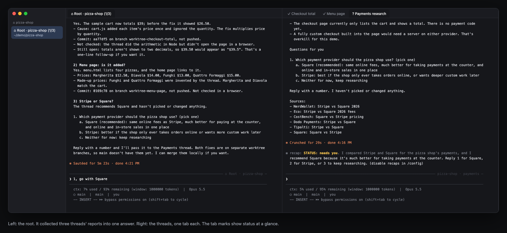
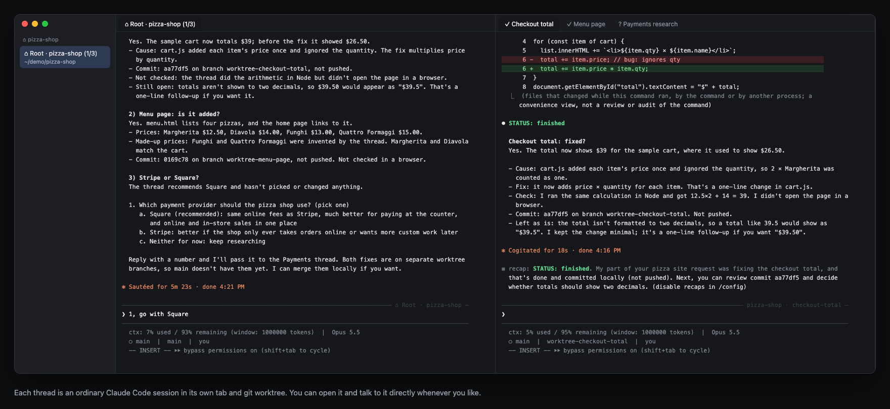
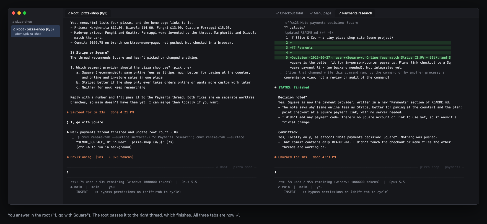

# cmux-threads

**Talk to one Claude. It runs the others for you.**

If you use Claude Code today, you probably run `claude` in a terminal, give it a task, and wait. When a second task comes up, you open another terminal tab, run `claude` again, and now you're switching tabs to check which one is done, which one is stuck on a question, and what each one said.

cmux-threads is a Claude Code skill that does that switching for you. You talk to one session, the **root**. For every task you give it, the root starts a separate Claude Code session, a **thread**, in its own tab. It watches the threads, marks each tab with its status, and comes back to you with one short report: what finished, and the exact questions that need your answer.



*A real run on a made-up "pizza-shop" project: one request with three tasks became three threads. The root's answer on the left sums them up. The tabs on the right are the threads, marked ✓ finished or ? needs you.*

## Before and after

| Plain `claude` in a terminal | With cmux-threads |
|---|---|
| One task per session; you open more tabs by hand | You describe tasks in one place; the root opens a session per task |
| You switch tabs to see who is done or waiting | Tab titles show status: `▶` working, `?` needs you, `✓` finished, `✗` failed |
| You scroll each session to find its question | The root collects every question into one numbered list |
| You reply in the right tab | You reply in the root; it forwards your answer to the right thread |
| Parallel code changes collide in one checkout | Each thread that changes code gets its own git worktree (`claude -w`); research threads don't need one |

You can still open any thread's tab and talk to it directly. A thread is just an ordinary Claude Code session.

## How it works

```
 you ──▶ ⌂ Root · pizza-shop          one Claude Code session you talk to
            │  starts, watches, relays
            ├──▶ ✓ Checkout total     its own Claude Code session in a tab,
            ├──▶ ✓ Menu page          plus its own git worktree (it changes code)
            └──▶ ? Payments research  research only: no worktree; waiting for your answer
```

1. You tell the root what you want, in plain words. Several tasks in one message is fine.
2. The root splits it into topics and starts one thread per topic in a cmux tab, with a prompt that includes your request word for word.
3. Each thread reports with a status line (`STATUS: working`, `needs you` or `finished`). The root reads the tabs and renames them with the matching mark.
4. The root tells you only what matters: finished work (with the commit or branch) and questions for you, as numbered options you can answer with a number.



*The "Checkout total" thread: it fixed the bug in its own worktree, committed, and reported `STATUS: finished`.*



*You answer the root ("1, go with Square"). It forwards your answer to the Payments thread, which records the decision and finishes. The root's count drops to (0/3).*

## What you need

- **macOS with [cmux](https://cmux.dev)**, a terminal app with tabs, panes and a command-line tool (`cmux`) that lets one session open and read other tabs. That's what makes this possible. Tested with cmux 0.64.
- **Claude Code** (`claude`), signed in. Tested with 2.1.
- `jq`, plus the usual bash, sed and grep.

## Install

```bash
git clone https://github.com/demoatworkstream/cmux-threads-public.git ~/.claude/skills/cmux-threads
chmod +x ~/.claude/skills/cmux-threads/scripts/*.sh
```

Claude Code loads skills from `~/.claude/skills/` automatically. To update later, run `git -C ~/.claude/skills/cmux-threads pull`.

## Use it

1. Open cmux and `cd` into your project.
2. Run `claude`, then type `/cmux-threads`. This session is now the root for the project. Its tab becomes `⌂ Root · <project> (active/total)`.
3. Ask for things the way you normally would:
   > Fix the checkout total, add a menu page, and research Stripe vs Square. Ask me before picking one.
4. Keep talking to the root: "status?", answers to its questions ("1"), new tasks, or "close the finished threads".

Tips:
- Ask for a plan first on anything big: "plan it and wait for my OK". The thread then stops with `? needs you` before it changes code.
- Threads that change code get their own git worktree and branch, so they don't step on each other. Merging is up to you, or ask the root to do it.
- With several projects, run `/cmux-threads master` in its own workspace. You get one entry point above every project's root.

## Be aware

- **Threads run without permission prompts.** They start with `claude --dangerously-skip-permissions`, because nobody is watching each tab to click "allow". Use this only in repos where you're fine with that, and ask for a plan first on anything risky.
- **More sessions, more usage.** Every thread is a full Claude Code session.
- **Threads don't ping the root.** The root sees news when it checks, either when you ask or on a schedule you set.

## Optional extras

You don't need any of these to start:

- **Phone access:** threads start with Claude Code's Remote Control, so you can follow and answer them from the Claude app.
- **threadsd** (`threadsd/`): a small local daemon that serves live status of every session over your Tailscale network, for a phone or a dashboard. See [ui/threadsd-api.md](ui/threadsd-api.md).
- **Codex threads:** [agents/codex.md](agents/codex.md) runs a thread on the `codex` CLI instead of Claude.
- **Several Macs:** [machines.md](machines.md).
- **Design review gate:** [gates/design-review.md](gates/design-review.md). UI work isn't reported finished until a reviewer session passes it.

## Files

- [SKILL.md](SKILL.md): the skill itself, i.e. the instructions the root follows.
- `agents/`: one file per agent type (Claude Code, Codex): how to launch one, type into it and read its status.
- `scripts/`: helpers. `new-root.sh` creates a project root; `rc-recover.sh` turns Remote Control back on after an account switch.
- `threadsd/`: the optional daemon. [EXTENDING.md](EXTENDING.md) explains how to add agents, status sources or UIs.
- `docs/screenshots/`: the images above. They are rendered from the text of real cmux screens (`cmux read-screen`) in a demo run, with the username replaced.

## License

MIT. See [LICENSE](LICENSE).
